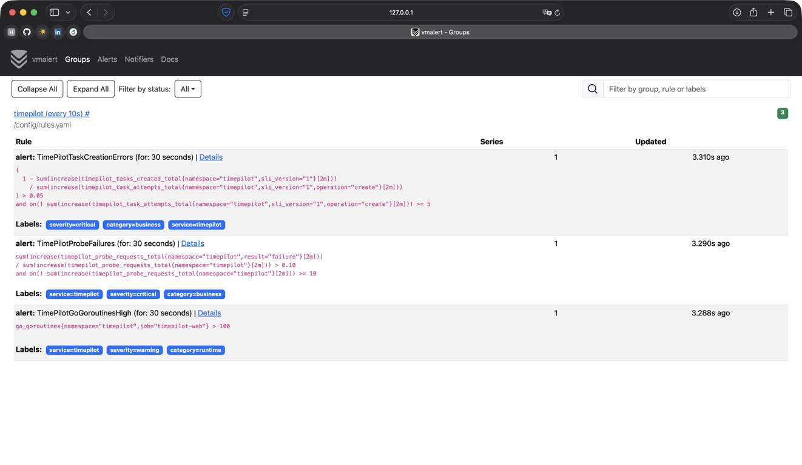
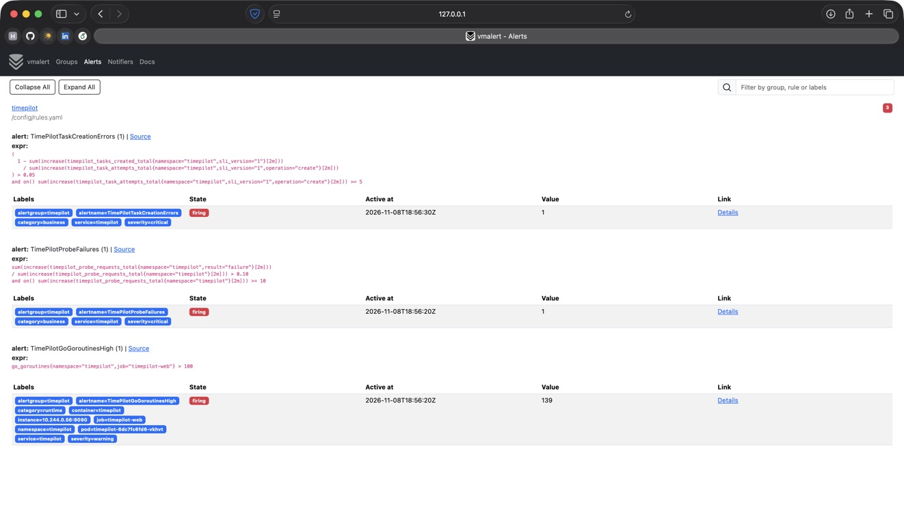
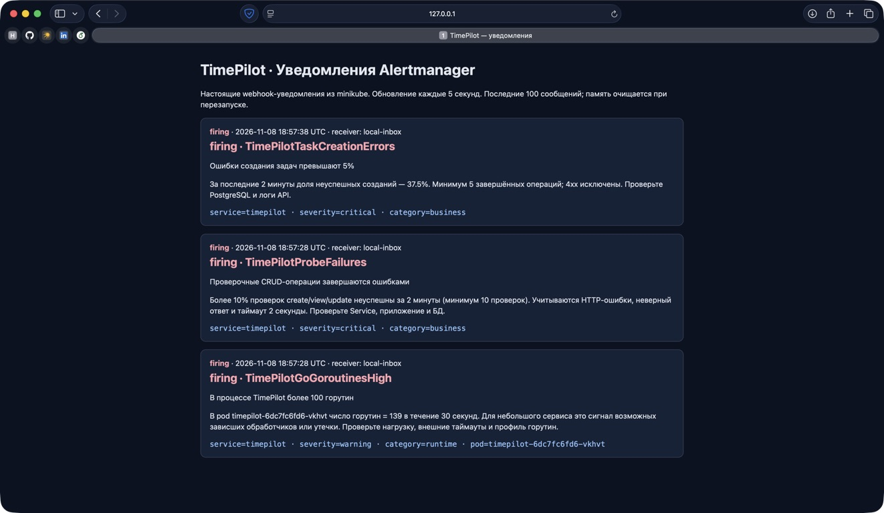
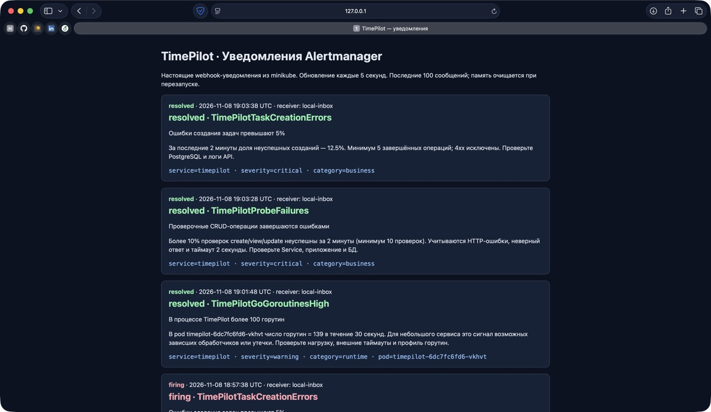

# Мониторинг и алерты TimePilot

## Стек и схема доставки

TimePilot — планировщик задач на Go с PostgreSQL. Метрики приложения и пробера собирает VictoriaMetrics single-node в minikube. Go-метрики экспортирует готовый `prometheus/client_golang` (`collectors.NewGoCollector`), а не вручную заданные gauges.

Правила вычисляет **vmalert v1.134.0**, уведомления маршрутизирует **Alertmanager v0.28.1**. Получатель — отдельный процесс `timepilot notify`, принимающий стандартные webhook POST и показывающий их на локальной веб-странице. Это полноценная доставка уведомления, а не только статус firing в движке правил. Внешние интеграции не требуются.

Путь данных: приложение/пробер → `/metrics` → VictoriaMetrics → vmalert → Alertmanager → `alert-inbox` → страница уведомлений.

Все компоненты работают в том же minikube. Конфигурации:

- [rules.yaml](rules.yaml) — три алерта.
- [alertmanager.yaml](alertmanager.yaml) — группировка, задержки и webhook.
- [stack.yaml](stack.yaml) — Deployment и ClusterIP Service для компонентов.
- [kustomization.yaml](kustomization.yaml) — сборка ConfigMap из файлов без дублирования правил. Хеш имени ConfigMap меняется при редактировании, вызывая обновление pod.

## Выбранные условия и причины

| Алерт | Условие | Почему выбран |
| --- | --- | --- |
| `TimePilotTaskCreationErrors` | Доля ошибок создания задач >5% за 2m, минимум 5 операций, постоянно 30s | Создание задачи — ключевое бизнес-действие. Отлавливает регрессию API или проблемы БД. Порог количества снижает шум от единичного запроса. |
| `TimePilotProbeFailures` | >10% неуспешных проверок CRUD за 2m, минимум 10 проверок, постоянно 30s | Проверяет пользовательский путь через Service и API: создание, чтение, изменение. В отличие от первого алерта, включает таймауты, транспортные ошибки и неверный ответ. |
| `TimePilotGoGoroutinesHigh` | `go_goroutines{namespace="timepilot",job="timepilot-web"} > 100` постоянно 30s | Настоящая метрика рантайма Go. Рост числа горутин может указывать на утечку или зависшие обработчики. Проверяется отдельно для каждого pod; число реплик не складывается. |

Для первых двух алертов severity=`critical`, для runtime — `warning`. Метки `service=timepilot` и `category=business/runtime` позволяют разделить уведомления.

### Расчёт бизнес-метрик

Первый алерт:

```text
error_ratio = 1 − Δtimepilot_tasks_created_total / Δtimepilot_task_attempts_total{operation="create"}
```

Оба счётчика берутся только с `sli_version="1"` из namespace `timepilot`, на одном окне 2m. При перезапуске счётчиков `increase` обрабатывает reset. Сначала вычисляется `increase` отдельно для рядов, затем сумма по репликам. В знаменатель включены ответы 2xx и 5xx; некорректные клиентские запросы 4xx исключены. При отсутствии операций алерт не возникает: это **не означает доступность 100%**.

Второй алерт:

```text
probe_error_ratio = ΣΔtimepilot_probe_requests_total{result="failure"}
                    / ΣΔtimepilot_probe_requests_total
```

Пробер каждые 5s выполняет create/view/update, проверяя HTTP-ответ и содержимое. Таймаут каждой операции — 2s. Он работает только со своими canary-задачами, не изменяя пользовательские. При прекращении работы самого пробера этот алерт со временем перестанет иметь данные; для промышленного мониторинга дополнительно нужен отдельный no-data/heartbeat-алерт.

### Интервалы и ограничения

- Scrape — 10s, оценка правил — 10s.
- `evalDelay=30s` учитывает задержку видимости свежих данных VictoriaMetrics.
- `for: 30s` требует непрерывного выполнения условия, а не одной вспышки.
- Окна 2m и короткие задержки выбраны для воспроизводимой учебной демонстрации. Это не новые SLO/SLA за месяц и не замена их порогам.
- Порог 100 горутин выбран для небольшого TimePilot, а не как универсальная норма Go; в эксплуатации он калибруется по baseline и нагрузочному тесту. Сам по себе высокий gauge не доказывает утечку.
- При сбое самого VictoriaMetrics/vmalert текущая цепочка не может гарантировать оповещение. Для production нужны внешняя проверка цепочки, надёжный канал уведомлений, персистентное хранение состояния Alertmanager и история уведомлений.

## Настройка Alertmanager

Уведомления группируются по `[service, alertname]`: каждое правило образует отдельную группу. Первая отправка после firing — через 5s (`group_wait`), обновление группы — не чаще 10s, повтор неизменившегося алерта — через 30m. Включён `send_resolved: true`.

Адрес получателя: `http://alert-inbox.monitoring.svc.cluster.local:9095/webhook`. Все Service — ClusterIP; страницы открываются через localhost port-forward. В конфигурации нет секретов.

Для простоты в учебной инсталляции состояние Alertmanager — `emptyDir`, последние 100 принятых уведомлений — в памяти приёмника. При перезапуске теряются silences/дедупликация и история соответственно; это явно не production-хранилище.

## Воспроизводимое срабатывание

В код добавлен ограниченный runtime-деморежим: `POST /demo/runtime {"enabled":true}` создаёт ровно 128 ожидающих горутин, не занимающих CPU активным циклом. Повторный запрос не добавляет новые. Метрика `go_goroutines` измеряет их реальное количество штатным Go collector. Подмена значения метрики и снижение порога для скриншота не используются.

Управляющие маршруты находятся только на внутреннем порту 9090 и существуют лишь при `SLO_DEMO_ENABLED=true`; на публичном 8080 их нет. Режим `healthy` освобождает горутины, отдельный `{"enabled":false}` также их освобождает. Перезапуск сбрасывает демонстрационные режимы. Для рабочего окружения флаг необходимо выключить; внутри кластера одного ClusterIP недостаточно как механизма авторизации.

Сценарий:

```sh
./alerting/demo.sh business  # реальные HTTP 503 для create/view/update
./alerting/demo.sh runtime   # реальные 128 ожидающих горутин
# Дождаться firing и доставки уведомлений, сделать скриншоты.
./alerting/demo.sh healthy   # восстановить CRUD и освободить горутины
# Дождаться resolved после выхода ошибок из окна 2m.
```

Не затрагиваются health/readiness, чтение списка задач и удаление. PostgreSQL не отключается, пользовательские данные не удаляются. Полные шаги запуска и повторной проверки — [README.md](README.md).

## Скриншоты

Скриншоты ниже сделаны при реальном запуске в minikube 8 ноября 2026 года. Все три правила вычислялись без ошибок (`health=ok`); `amtool check-config` подтвердил корректность конфигурации Alertmanager. На стороне приёмника зафиксированы три отдельных webhook-уведомления. Go-тесты с `-race` и `go vet` прошли.

### 1. Настроенные правила



Видны два бизнес-правила, одно runtime-правило и выражения с порогами. Все правила должны иметь health=ok.

### 2. Срабатывание



Правила перешли в firing после выдержки 30s. Runtime-алерт относится к pod приложения, не пробера.

### 3. Полученные уведомления



На стороне приёмника показаны настоящие сообщения со статусом firing для трёх алертов: бизнес-ошибки, провал CRUD-проверок и рост числа горутин. В сообщениях есть время получения, имя алерта, причина, severity и category.

### 4. Восстановление (дополнительно)



После возвращения healthy число горутин снижается, CRUD-проверки снова успешны. По окончании окна ошибок Alertmanager отправляет resolved.

В проверке runtime-метрика снизилась с 139 до 12 горутин сразу после выключения демонстрации. В `resolved` аннотация может содержать последнее значение, при котором алерт ещё был активен (на снимке — 139 горутин и 12.5% ошибок). Это историческое значение, не текущая метрика; восстановление определяется статусом `resolved`. Все три алерта закрылись, список активных алертов стал пустым.

## Источники

- [vmalert: правила, datasource, notifier и состояние алертов](https://docs.victoriametrics.com/victoriametrics/vmalert/).
- [Alertmanager: маршрутизация и webhook receivers](https://prometheus.io/docs/alerting/latest/configuration/).
- [Готовый Go collector в client_golang](https://github.com/prometheus/client_golang/blob/v1.20.5/prometheus/go_collector.go).
