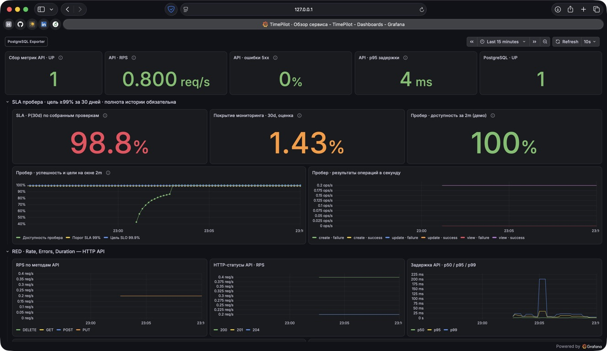
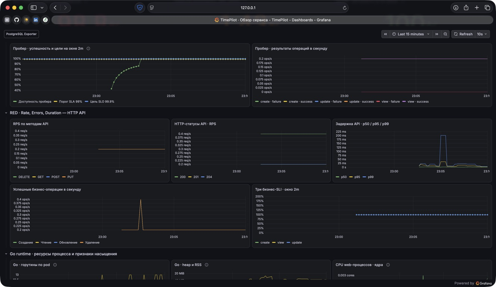
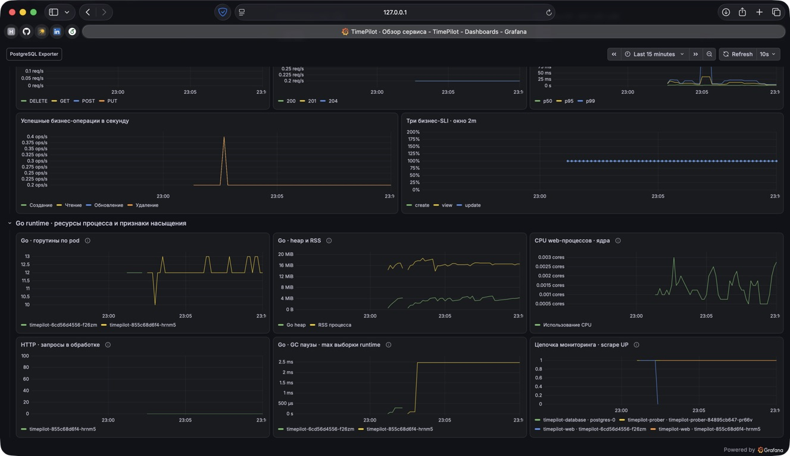
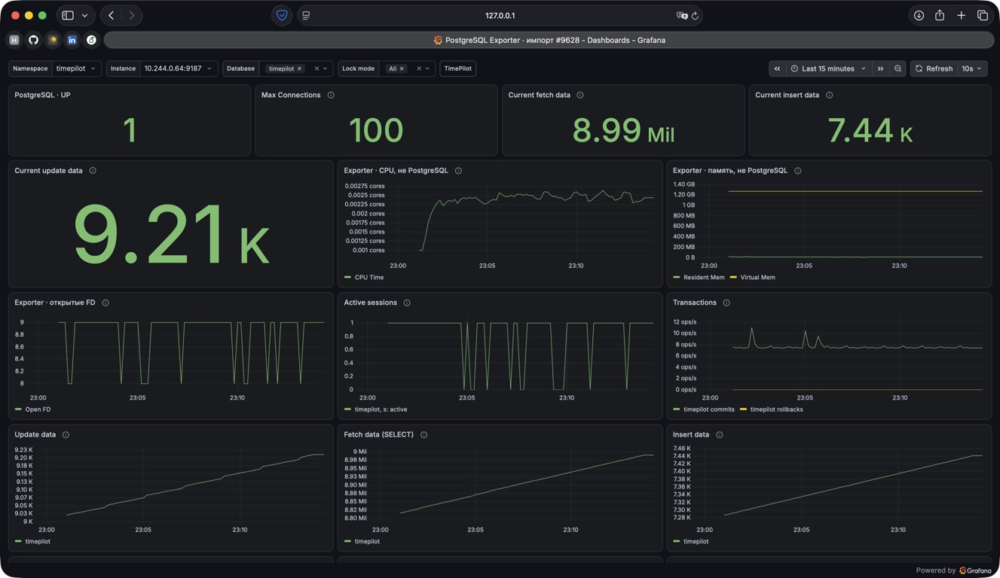
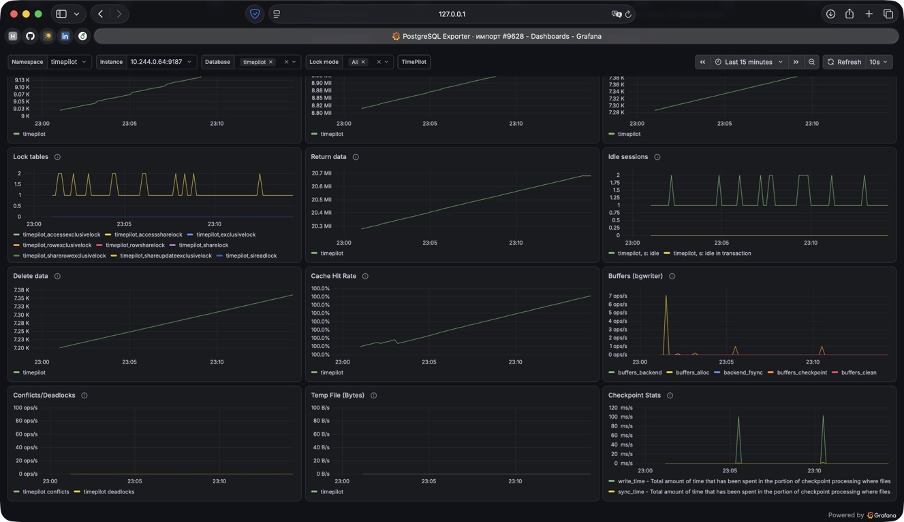

# Дашборды TimePilot в Grafana

## 1. Стек и источник данных

В существующем minikube установлена Grafana **13.3.1**, Helm-чарт `grafana-community/grafana` **14.4.1**. Состояние Grafana сохраняется на PVC 1Gi; наружу она не опубликована, доступ — через `kubectl port-forward svc/grafana 3000:80 -n monitoring`.

Единый источник данных обоих дашбордов — **VictoriaMetrics single-node**, установленная в предыдущем ДЗ. Использован встроенный **Prometheus datasource** с UID `victoriametrics` и URL:

```text
http://victoria-metrics.monitoring.svc.cluster.local:8428
```

VictoriaMetrics собирает метрики через Pod service discovery и аннотации `prometheus.io/`:

- TimePilot (`job="timepilot-web"`, порт 9090) — HTTP, бизнес-метрики, Go runtime/process collector.
- CRUD-пробер (`job="timepilot-prober"`, порт 9091) — результаты синтетических операций.
- PostgreSQL Exporter **v0.18.1** (`job="timepilot-database"`, порт 9187 в pod PostgreSQL) — состояние БД и внутренние метрики самого экспортера.

Datasource и TimePilot provisioned из файлов. PostgreSQL-дашборд импортирован через HTTP API Grafana. [values.yaml](values.yaml) и скрипты сохраняют воспроизводимость без установки дополнительных Grafana-плагинов.

## 2. Дашборд приложения

UID: `timepilot-overview`. Требуемый экспорт из реально запущенной Grafana: [exports/timepilot.json](exports/timepilot.json).

### Верхнеуровневое состояние и SLA



| Панели | Метрики / расчёт | Зачем |
| --- | --- | --- |
| Сбор метрик API · UP | `min(up{job="timepilot-web"})` | Контроль scrape-доступности всех обнаруженных реплик; не подменяет пользовательскую доступность. |
| API · RPS | `sum(rate(timepilot_http_requests_total{route=~"/api/.*"}[W]))` | Интенсивность API-трафика, включая синтетический; без frontend и Kubernetes health checks. |
| API · ошибки 5xx | `100 × rate(5xx) / rate(всех API-запросов)` | Доля серверных ошибок. При нулевом трафике показатель не определён, а не автоматически 0%. |
| API · p95 задержки | `histogram_quantile(0.95, sum by(le)(rate(timepilot_http_request_duration_seconds_bucket[W])))` с фильтром API | Задержка большинства запросов с учётом БД. Это оценка по buckets; точные сырые длительности не хранятся. |
| PostgreSQL · UP | `pg_up` | Доступность подключения экспортера к БД. |

Вместо жёстко заданного `[W]` в RED-панелях используется `$__rate_interval`, согласованный с scrape 10s через datasource. Для краткосрочных SLI зафиксировано окно 2m.

### RED и бизнес-операции



Показаны RPS по HTTP-методам, RPS по кодам ответа, задержки p50/p95/p99, скорость успешных созданий/чтений/обновлений/удалений и три бизнес-SLI из прошлого ДЗ. Они позволяют перейти от общего симптома к виду операции и характеру ответа.

Для RED в приложение добавлены:

- `timepilot_http_requests_total{method,route,status}` — Counter завершённых HTTP-запросов.
- `timepilot_http_request_duration_seconds{method,route}` — Histogram длительности обработчика, включая работу с PostgreSQL.
- `timepilot_http_in_flight_requests` — Gauge запросов в обработке.

В `route` попадает **шаблон** `/api/v1/tasks/{id}`, а не ID задачи или произвольный URL. Это ограничивает кардинальность. Считаются в том числе 4xx, 5xx и обработанные паники. Бизнес-SLI по-прежнему исключают 4xx из своей выборки; эти две формулы намеренно измеряют разные вещи.

Бизнес-счётчики и их `sli_version="1"` сохранены. В SLI сначала вычисляется `increase` каждого ряда, затем сумма по репликам — сбросы counters учитываются корректно.

### Go runtime и ресурсы



- `go_goroutines` по pod — конкуренция и возможные зависания/утечки.
- `go_memstats_heap_alloc_bytes` и `process_resident_memory_bytes` — память Go heap и RSS процесса в байтах.
- `rate(process_cpu_seconds_total[W])` — использование CPU в ядрах, не проценты CPU всей машины.
- `timepilot_http_in_flight_requests` — число одновременно выполняющихся запросов; при малом трафике scrape может видеть 0.
- `go_gc_duration_seconds{quantile="1"}` — максимум в экспортируемой runtime-выборке GC-пауз. Это не максимум за выбранное окно Grafana. В используемом Go collector нет квантиля 0.99; выдуманная метрика p99 не используется.
- `up` web/prober/database — состояние цепочки сбора.

Соответствие подходам: **RED** — rate, errors, duration; **Golden Signals** — traffic, errors, latency и признаки насыщения (in-flight, горутины, ресурсы); **USE** применён частично на уровне процесса (CPU, память, конкурентная работа). Проценты лимитов контейнеров, дисковые очереди и полную утилизацию Kubernetes-нод решение не заявляет: kube-state-metrics/cAdvisor/node-exporter для этого задания не добавлялись.

## 3. Отдельная панель SLA пробера

На первом скриншоте отдельная панель **«SLA · P(30d) по собранным проверкам»** рассчитывает ранее сформулированный request-based показатель:

```promql
100 * sum(increase(timepilot_probe_requests_total{namespace="timepilot",result="success"}[30d]))
  / sum(increase(timepilot_probe_requests_total{namespace="timepilot"}[30d]))
```

Цель SLA — **не менее 99%** за скользящие 30 дней. Пробер примерно каждые 5s проверяет create/view/update через Service и API. Успешная проверка — ожидаемый HTTP-ответ и корректные данные не дольше 2s. Таймауты и транспортные ошибки входят в неуспешные проверки.

Рядом отдельно показано **покрытие мониторинга за 30d**, приблизительно:

```text
100 × число сохранённых scrape-попыток пробера / (30 дней / 10 секунд)
```

В текущей одно-репличной Recreate-инсталляции это полезная оценка полноты, но не отдельный SLI доступности. На снимке покрытие низкое, поскольку учебный minikube останавливался. Полученные около **98.8%** — результат по имеющимся проверкам, **не заключение о нарушении/выполнении SLA за полный месяц**. Пробелы не превращаются в успешные запросы. Retention VictoriaMetrics 31d сохранён; недостающая история задним числом не создаётся.

Для живой демонстрации также выведены **P(2m)**, график успешности за 2m и горизонтальные цели SLA=99% / SLO=99.9%. Короткое окно явно помечено как демонстрационное, оно не подменяет месячный расчёт.

## 4. Импортированный PostgreSQL Exporter





Источник: опубликованный дашборд [PostgreSQL Database #9628, revision 8](https://grafana.com/grafana/dashboards/9628-postgresql-database/). Полный оригинал сохранён в [vendor/postgres-9628-rev8.json](vendor/postgres-9628-rev8.json). UID импортированной версии — `timepilot-postgres`, дополнительный экспорт: [exports/postgres-exporter.json](exports/postgres-exporter.json).

Исходная версия использовала старые панели `graph`/`singlestat` и метки `release`/`kubernetes_namespace`, отсутствующие в нашем service discovery. Скрипт [build_dashboards.py](build_dashboards.py) воспроизводимо адаптирует её:

1. Переводит основные панели в `timeseries`/`stat`, сохраняет происхождение и исходные ID в описаниях.
2. Подключает datasource `victoriametrics`, метки `namespace`, `job`, `instance` и переменные Instance/Database/Lock mode.
3. Оставляет основные эксплуатационные панели; дополнительные настройки/version из каталога исключены для компактности. Полный оригинал приложен.
4. Исправляет некорректный `rate` от gauges памяти, единицы измерения (строки — не байты, checkpoint time — ms/s), агрегирует сессии по БД/состоянию и не отбрасывает реальные нулевые значения сессий/блокировок.
5. Явно подписывает CPU/RSS/FD как **ресурсы экспортера, а не PostgreSQL**. Процессные метрики в scrape экспортера не измеряют серверный процесс БД.

В работающем дашборде видны `pg_up`, max connections, транзакции commit/rollback, прочитанные/вставленные/обновлённые/удалённые строки, активные/idle-сессии, блокировки, cache hit ratio, bgwriter, конфликты/deadlocks, временные файлы и checkpoints. Ноль deadlocks/rollback/temp — нормальное значение, не отсутствие данных.

## 5. Проверка и план демонстрации

13 ноября 2026 года выполнены: запуск в minikube, успешный health-check datasource, импорт PostgreSQL, проверка всех запросов обоих установленных дашбордов на конечные значения из VictoriaMetrics, экспорт через API Grafana. Новые HTTP-метрики проверены Go-тестами с `-race` и `go vet`, включая шаблоны маршрутов, 404, 503 и обработанную панику 500. Скриншоты сняты с настоящей Grafana на Mac.

В короткой демонстрации следует показать верхние показатели TimePilot, отдельный расчёт SLA с оговоркой о полноте истории, Go runtime и импортированный PostgreSQL Exporter с выбранной БД. План записи и команды — в [README.md](README.md). Скринкаст добавляется отдельным файлом к итоговым артефактам.

## Источники

- [Grafana: Helm installation](https://grafana.com/docs/grafana/latest/setup-grafana/installation/helm/).
- [Grafana: provisioning datasource и dashboards](https://grafana.com/docs/grafana/latest/administration/provisioning/).
- [VictoriaMetrics: интеграция с Grafana через Prometheus datasource](https://docs.victoriametrics.com/victoriametrics/integrations/grafana/).
