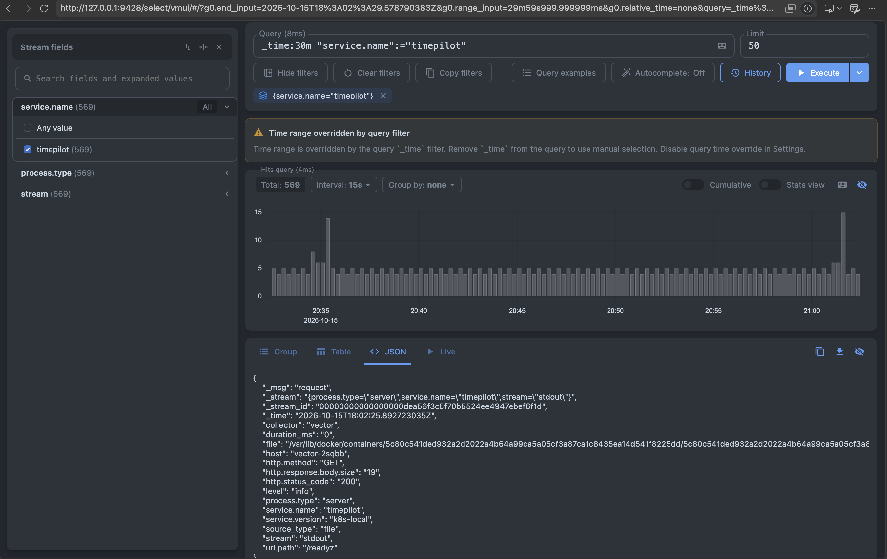
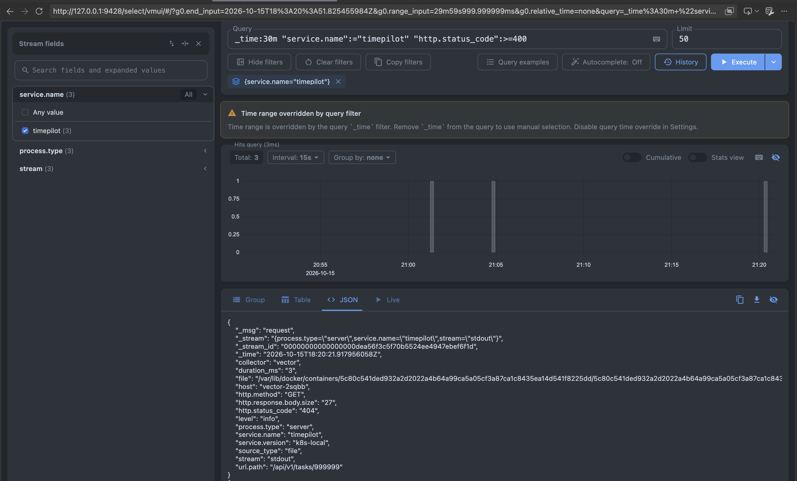
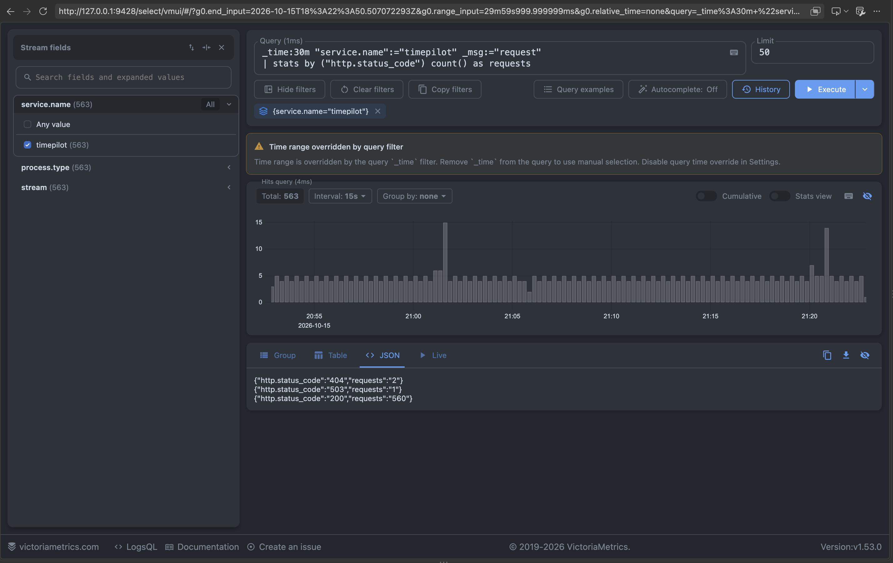
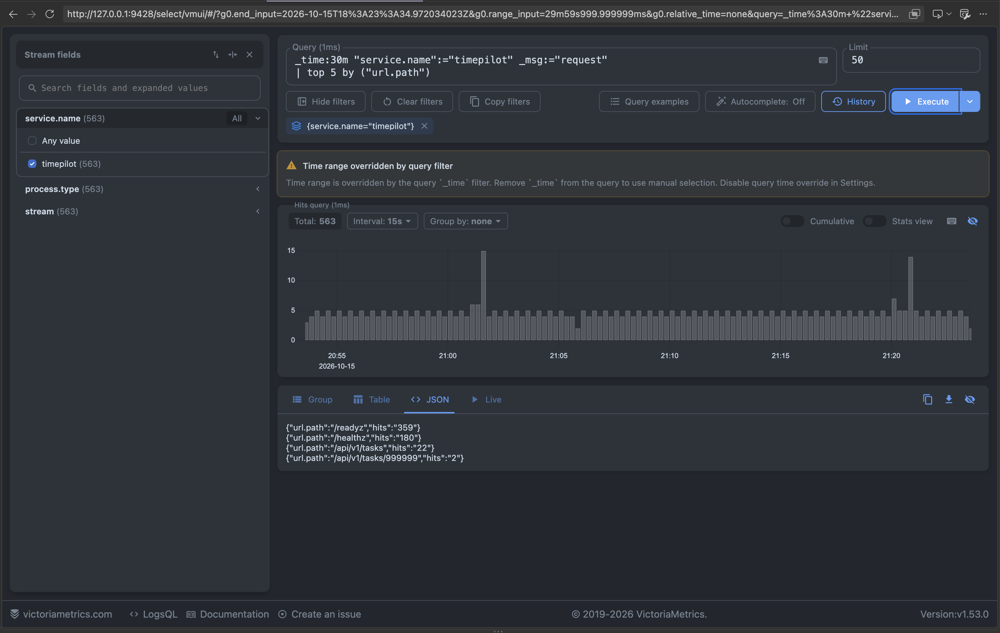

# Отчёт: централизованный сбор логов TimePilot

## 1. Цель работы

В однодовом кластере minikube развёрнута single-node VictoriaLogs. Логи web-подов
TimePilot собираются с узла агентом Vector и отправляются в VictoriaLogs. Для просмотра
и выполнения LogsQL-запросов используется встроенный интерфейс vmui.

## 2. Использованные компоненты

| Компонент | Назначение |
|---|---|
| TimePilot Deployment | формирует структурированные JSON-логи в stdout |
| Vector DaemonSet | читает container log-файлы узла, разбирает JSON и доставляет записи |
| VictoriaLogs Deployment | хранит и индексирует логи в single-node режиме |
| ClusterIP Service | предоставляет Vector адрес `victoria-logs.observability.svc:9428` |
| PersistentVolumeClaim | сохраняет данные VictoriaLogs при пересоздании Pod |
| vmui | выполняет LogsQL-запросы через `/select/vmui/` |

Версии образов зафиксированы в манифестах: VictoriaLogs `v1.53.0`, Vector
`0.59.0-alpine`.

## 3. Формат логов приложения

Backend использует стандартный пакет Go `log/slog` с JSON handler. Каждая запись
пишется одной строкой в stdout. Обязательные поля:

- `timestamp` — время события в RFC3339;
- `level` — уровень в нижнем регистре (`info` или `error`);
- `message` — тип события;
- `service.name` — постоянное значение `timepilot`;
- `service.version` и `process.type` — версия и тип процесса;
- `http.method`, `url.path`, `http.status_code`, `duration_ms` — поля HTTP-запросов.

Пример:

```json
{"timestamp":"2026-10-15T12:00:00Z","level":"info","message":"request","service.name":"timepilot","service.version":"k8s-local","process.type":"server","http.method":"GET","url.path":"/healthz","http.status_code":200,"duration_ms":0}
```

## 4. Способ доставки

Vector развёрнут как DaemonSet, поэтому на каждой Kubernetes-ноде работает один агент.
В данном minikube используется Docker runtime: ссылки в `/var/log/pods` указывают на
фактические файлы `/var/lib/docker/containers/*/*-json.log`. Поэтому Vector читает
эти файлы источником `file` из каталога, смонтированного read-only. Remap transform
сначала раскрывает служебную JSON-обёртку Docker, затем прикладной JSON из поля
`message`. Filter transform оставляет только события с `service.name=timepilot`,
поэтому логи системных компонентов кластера не отправляются.

После преобразования Vector отправляет записи с gzip-сжатием в Elasticsearch Bulk API:

```text
http://victoria-logs.observability.svc.cluster.local:9428/insert/elasticsearch/
```

Поля `service.name`, `process.type` и `stream` выбраны stream fields. Такой способ
доставки выбран потому, что приложение продолжает только писать в stdout и ничего
не знает о VictoriaLogs. Недоступность хранилища не влияет на обработку HTTP-запросов
самим приложением.

## 5. Проверка развёртывания

```bash
kubectl get pods,pvc,services -n observability
kubectl logs -n timepilot deployment/timepilot --tail=3
kubectl logs -n observability daemonset/vector --tail=30
```

vmui открывается локально:

```bash
kubectl port-forward -n observability service/victoria-logs 9428:9428
```

Адрес: <http://localhost:9428/select/vmui/>.

## 6. LogsQL-запросы

Перед созданием скриншотов выполнены обычные действия в UI и запрос к отсутствующей
задаче, который возвращает HTTP 404. Во всех запросах используется интервал 30 минут.

### 6.1. Сырые записи

```logsql
_time:30m "service.name":="timepilot"
```

Запрос показывает все записи TimePilot за последние 30 минут. По результату можно
проверить наличие обязательных JSON-полей и разных типов событий приложения.



### 6.2. Фильтр по конкретному полю

```logsql
_time:30m "service.name":="timepilot" "http.status_code":>=400
```

Запрос оставляет HTTP-запросы, завершившиеся клиентской или серверной ошибкой. В
демонстрационных данных виден ответ 404 для несуществующей задачи.



### 6.3. Stats с группировкой

```logsql
_time:30m "service.name":="timepilot" _msg:="request"
| stats by ("http.status_code") count() as requests
```

Запрос считает количество HTTP-запросов отдельно для каждого кода ответа. Он позволяет
быстро увидеть соотношение успешных операций, ошибок клиента и ошибок сервера.



### 6.4. Агрегирующий запрос top

```logsql
_time:30m "service.name":="timepilot" _msg:="request"
| top 5 by ("url.path")
```

Запрос показывает пять наиболее часто вызываемых HTTP-маршрутов TimePilot. Он выбран,
чтобы определить самые востребованные операции приложения без предварительно
подготовленных метрик.



## 7. Вывод

VictoriaLogs и Vector работают в том же minikube-кластере, что и TimePilot. Логи
приложения структурированы, собираются независимо от жизненного цикла web-подов,
сохраняются на PVC и доступны для полнотекстового поиска и агрегации через LogsQL.
